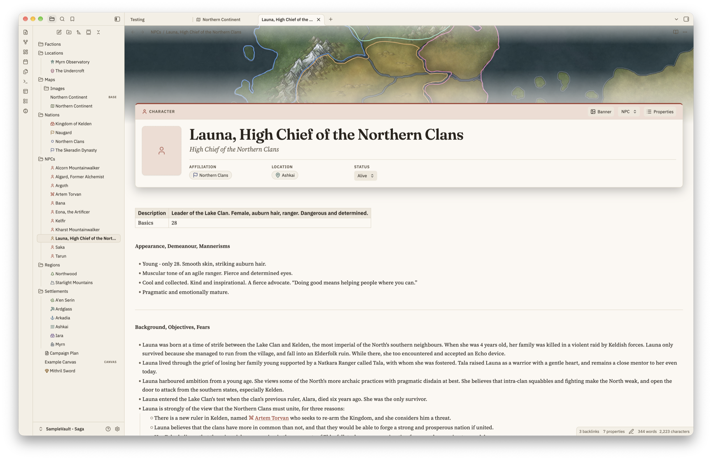
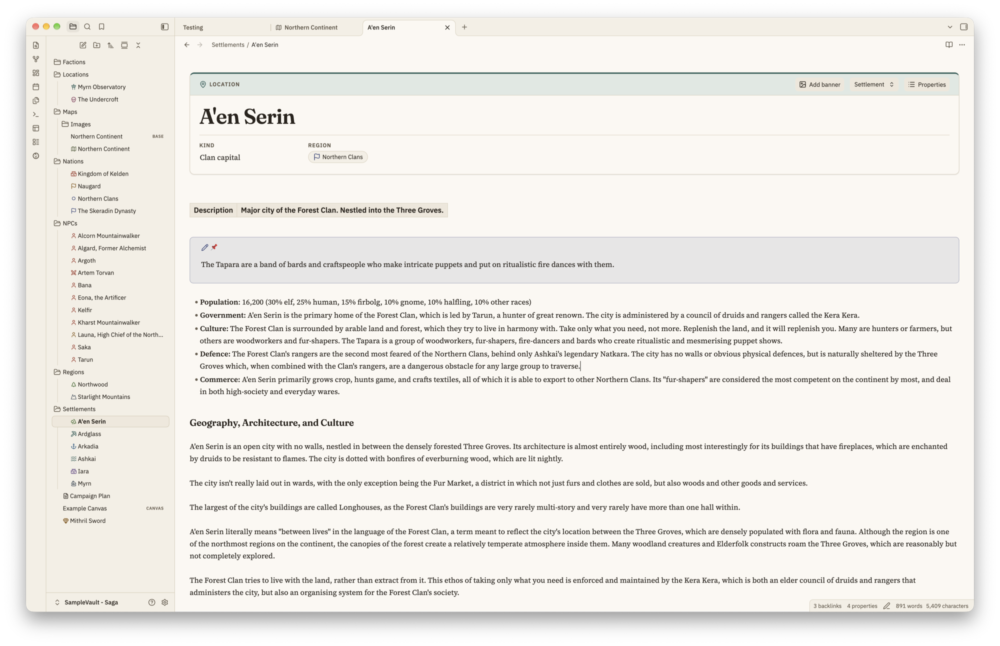
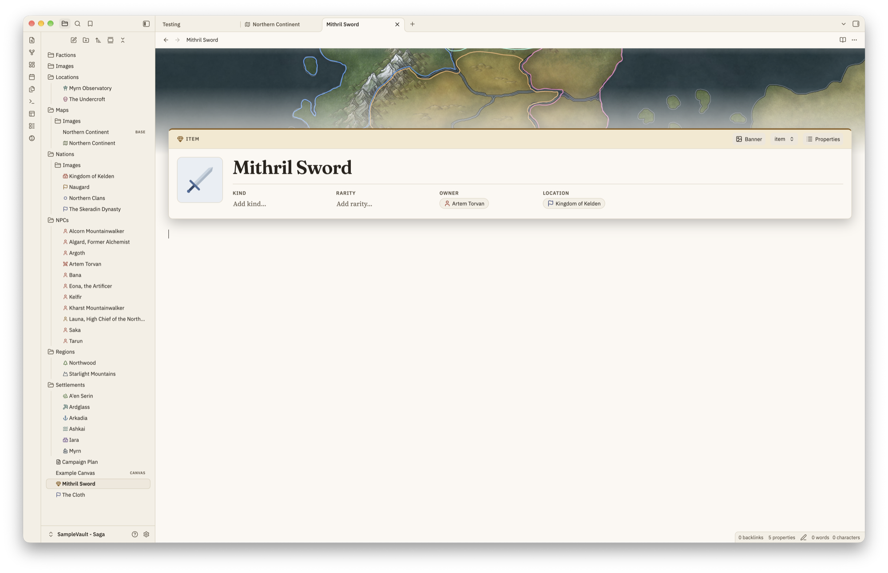
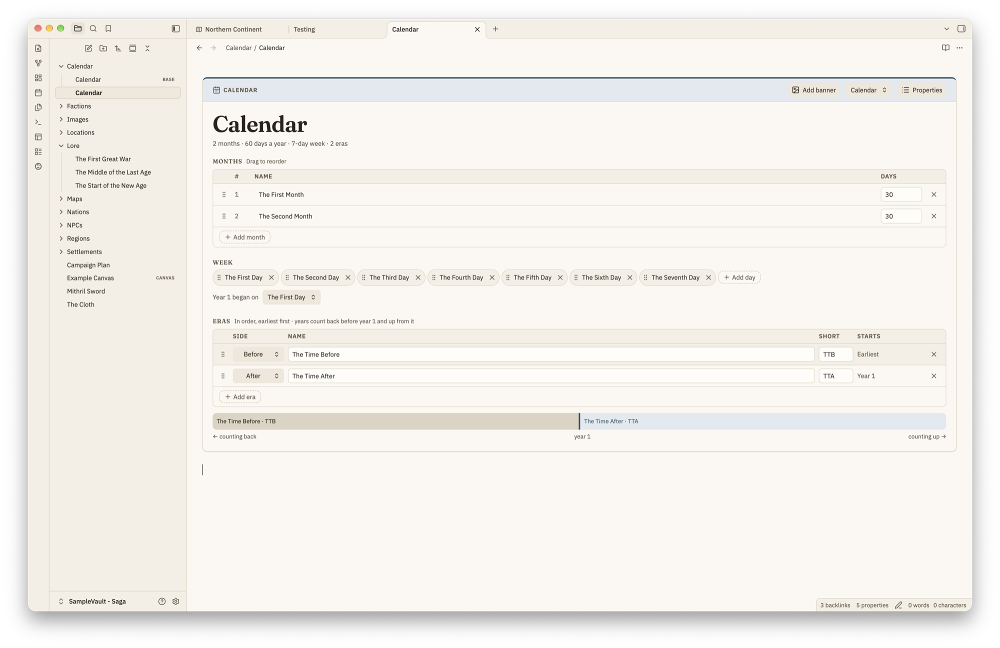
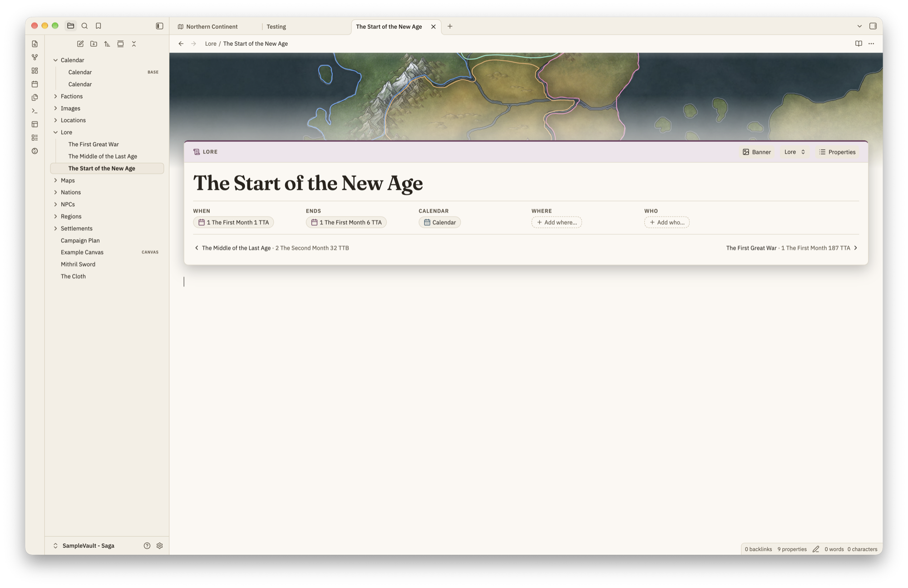
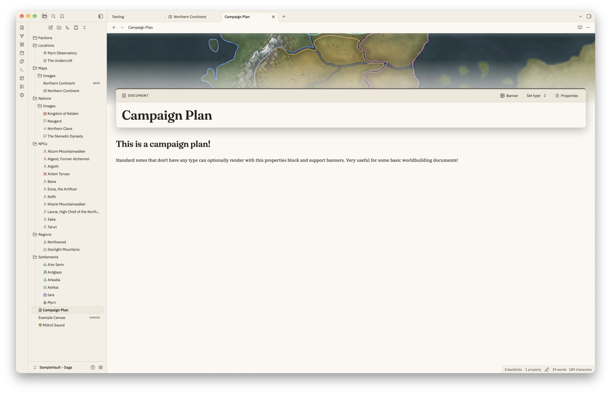
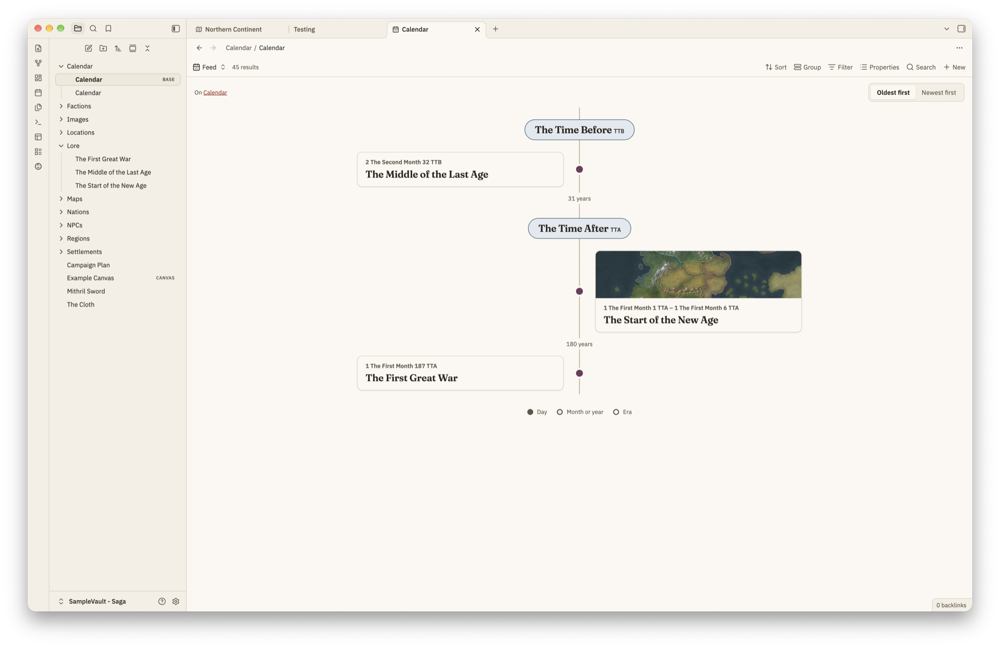
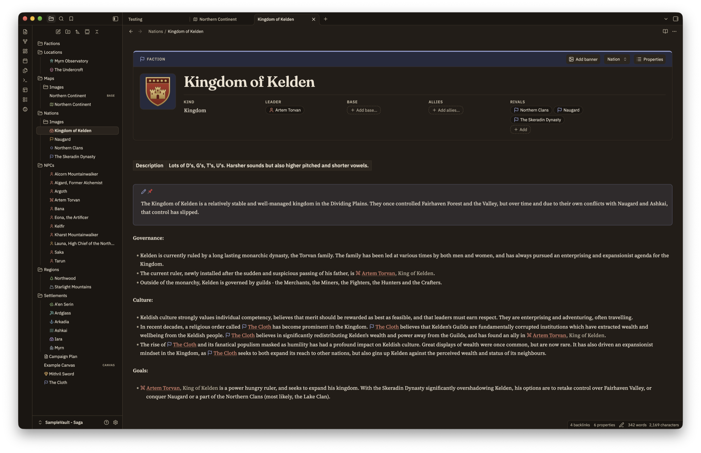

# Saga for Obsidian


Saga is a work-in-progress world-building plugin for Obsidian. It renders notes differently according to their type, adds banners, portraits and emblems to notes, shows icons for files and links, draws maps with customisable pins, and lays out your world's history on its own calendars, each in a custom Bases view. Every feature works on desktop and mobile, maps included.

Saga works best with the [Saga theme](https://community.obsidian.md/themes/saga).

> **AI Disclaimer:** Saga is 100% vibe-coded. I've no intention of claiming that "I made" Saga or could quickly or easily re-create it myself. It almost definitely has many AI-isms in its visual design and codebase.

## Renderers

A note's `type` property picks its renderer. The renderer replaces the inline title and properties with a header card: an image, the title, and fields you edit in place. The note's text stays below. The Properties button shows Obsidian's own properties.

| Renderer | Image | Fields |
| --- | --- | --- |
| Character | Portrait | Title, Affiliation, Location, Status |
| Location | Banner | Kind, Region |
| Faction | Emblem | Kind, Leader, Base, Allies, Rivals |
| Item | Image | Kind, Rarity, Owner, Location |
| Map | Banner | |
| Calendar | Optional banner | Months, Week, Eras |
| Lore | Optional banner | When, Ends, Calendar, Where, Who |
| Document | Optional banner | |

Notes with no `type`, or one that maps to no renderer, get the Document card. Any note can have a banner via the `banner` property, repositioned by dragging.

Settings → Saga sets the type property's key, which `type` values map to each renderer, each field's property key, and which fields show in the header. These are stored in `.saga/renderers.yaml`.

### Character


### Location


### Faction


### Item


### Map


### Calendar


### Lore


### Document


## Maps


**Saga map** is a Bases view. Pick a map note (`type: map` with an `image`) in the view's options; every note in the base with a pin on that map shows on it.

- Add, drag and remove pins from the map. Click a pin for a card with the note's excerpt and its look.
- Each pin has a shape (pin, circle, flag, bookmark, herald), one of 12 colours and an icon. Renderers set the default look; a pin can override it.
- Maps with more than 50 pins cluster them when zoomed out. Labels show always or on hover.
- A Layers panel hides pins by renderer or icon.
- On mobile: pinch to zoom, drag to pan, long-press for the pin and map menus.

Pins are stored in the note they point at, so the map note is never edited:

```yaml
map-pins:
  - map: "[[The Shattered Coast]]"
    x: 412.5
    y: 288
    shape: flag     # optional
    color: crimson  # optional
    icon: tent      # optional
```

`x` and `y` are image pixels from the top left.


## Calendars



A calendar is a note (`type: calendar`) that defines your world's months, week and eras. Edit them in its header: drag to reorder months and weekdays, and set where each era starts. Years count continuously, back before year 1 and up from it, with no year 0.

Lore notes (`type: lore` or `event`) link a calendar and carry a date, edited with a picker that knows that calendar. A date can be a day, a month, a year or a whole era, with an optional end. The Lore header links the notes just before and after it.

**Saga calendar** is a Bases view. Pick a calendar note in the view's options; every note in the base dated on it shows, as one of:

- **Calendar:** a month or year grid, with multi-day events as bars and notes dated only to a month or year in their own row.
- **Feed:** a timeline of cards with banners and excerpts, grouped by era, with the years between events marked. Oldest or newest first.
- **Timeline:** one row per note across every era, or a century, decade or year at a time.

Click a note for a card with its date and excerpt. Right-click it (long-press on mobile) to rename it, change its dates, or delete it.

Dates are stored as flat properties, so Bases can sort and filter on them, and the calendar note is never edited by a date change:

```yaml
type: event
calendar: "[[The Tidereckoning]]"
year: 1312        # 1 BL is -1; there is no year 0
month: 4          # 1-based
day: 28
end-year: 1312    # optional
end-month: 6
end-day: 12
```

An era-only date uses `era: Age of Lanterns` in place of `year`.

## Icons

Optional, in Settings → Saga.

- **File explorer:** notes show their renderer's icon; folders show open and closed folder icons.
- **Wikilinks:** links in note text show the linked note's icon. Links to characters can also show their title, e.g. *Ada Lovelace, Countess of Lovelace*.

Icons use either the renderer's icon and colour, or the note's pin look on a chosen map.


## Other features

- **PDF export:** Export to PDF prints the banner and header card (desktop).
- **Field editing:** link fields use Obsidian's note suggester; image fields use an image suggester.
- **Hover previews:** map pins, calendar entries and header link fields show Obsidian's page preview.
- **Text-preserving writes:** edits change only the edited property's text in the note.

## Saga theme




Saga works with any theme, but is designed alongside the [Saga theme](https://community.obsidian.md/themes/saga): a serif parchment theme with light and dark schemes. The theme sets Saga's renderer colours, and adds its own callouts (`secret`, `statblock`, `read-aloud`) and alternative checkboxes.

## Install

Requires Obsidian 1.10.2 or later.

Install:

- via the Obsidian community store
- via [BRAT](https://github.com/TfTHacker/obsidian42-brat): Add beta plugin, `lobrenov/saga-obsidian`

Or build it:

```bash
npm install
```

```bash
npm run build
```

Copy `main.js`, `styles.css` and `manifest.json` to `<vault>/.obsidian/plugins/saga/` and enable Saga in Community plugins.

## Implementation Notes

Obsidian's automated plugin review flags two things in Saga that can't be changed.

- **Settings don't appear in Obsidian's settings search.** Search covers settings built with an API that Obsidian added in version 1.13. Saga supports Obsidian 1.10.2 and up, and its settings page (renderer cards, pin previews) can't be built with that API.
- **"Only partially supported" CSS warnings** (multi-column layout, `display: contents`, `clip-path`). The checker judges these against a list of old browsers. Obsidian runs on current Chromium, and on iOS on current WebKit, which support all three fully.
